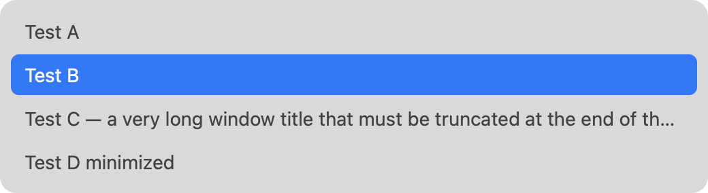

# OptionTab


A macOS menu bar app for the windows of one app. Command-Tab changes the app, as before. Option-Tab shows the titles of the frontmost app's windows on all Spaces, and the release of Option focuses the selected window.

OptionTab uses only the Accessibility permission. It never captures the screen, so macOS shows no purple screen-recording indicator.



## Requirements
- macOS 14 or later
- Xcode or the Swift 6 command line tools
- Optional: an Apple Development signing identity. With it, the Accessibility permission stays after a rebuild.

## Install
```bash
./build.sh --install
```
This builds the app, copies it to `/Applications`, and opens it. On the first launch, turn on **OptionTab** in **System Settings > Privacy & Security > Accessibility**. The installed copy starts at login.

## Use
| Keys | Result |
|------|--------|
| Option-Tab | Opens the list. The first Tab selects the previous window. |
| Tab or Shift-Tab, with Option held | Selects the next or previous window |
| Release Option | Focuses the selected window |
| Option-Esc | Closes the list. The focus does not change. |

If the menu bar is full, macOS hides the OptionTab icon. Open OptionTab again from Raycast, Spotlight, or Finder to show its menu at the mouse pointer.

## Private APIs
OptionTab uses private macOS functions to find windows on other Spaces and to focus them. If a function is missing, the app falls back to public APIs and lists only the current Space. For this reason, the app cannot go in the App Store.

## Documentation
The [`docs/`](docs/) folder has one file for each step: the feasibility analysis, the switcher, start at login, the icon, and the menu on reopen. Each file lists the test results and the known limits.
