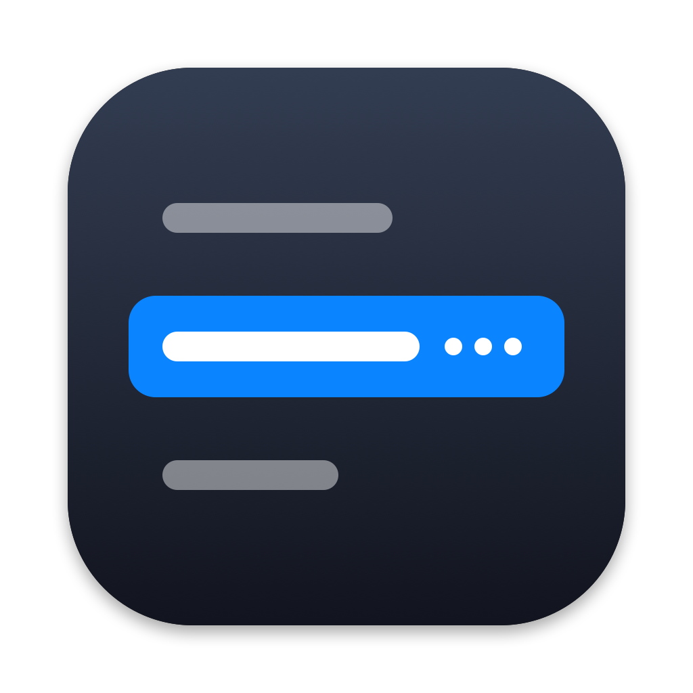

# App icon and menu bar icon

## What was done
OptionTab has its own icon now. The icon shows the switcher panel: three window titles, and the middle title is selected. The selected title ends with "…", because the panel truncates long titles at the end. A Swift script draws the icon with CoreGraphics, so no image editor is necessary. The menu bar item uses a small black-and-white version of the same design, in place of the SF Symbol `rectangle.stack`.



## Files created / modified
| File | Action | Purpose |
|------|--------|---------|
| `tools/make_icon.swift` | Created | Draws the icon at all sizes. Writes `Resources/AppIcon.icns` and the preview image. |
| `Resources/AppIcon.icns` | Created | The app icon, 16 px to 1024 px |
| `docs/images/05_app_icon.png` | Created | Preview of the icon at 1024 px |
| `Resources/Info.plist` | Modified | Adds `CFBundleIconFile`. |
| `build.sh` | Modified | Copies `AppIcon.icns` into `Contents/Resources`. |
| `Sources/OptionTab/AppDelegate.swift` | Modified | Draws the menu bar icon as a template image. |

## Change the icon
1. Edit `drawIcon(in:)` in `tools/make_icon.swift`. The grid is 1024 × 1024 and the origin is at the bottom left.
2. Run the script from the project folder:
   ```bash
   swift tools/make_icon.swift
   ```
3. Run `./build.sh --install`.

The menu bar icon is separate. It is in `makeMenuBarIcon()` in `AppDelegate.swift`. If you change the design, change both.

## How it works
- **App icon.** The script draws the icon on a 1024 grid and scales it for each size. It keeps the macOS margin of 100 px on each side. Then `iconutil` packs the 10 images into `AppIcon.icns`.
- **Menu bar icon.** The app draws an 18 × 18 pt image with `NSBezierPath`. The selected row has a hole for its title (even-odd fill). The image is a template image, so macOS colors it to match a light or dark menu bar.

The new file in the bundle does not change the Accessibility permission. macOS checks the bundle ID and the signing identity, and both stay the same.

## Test results (2026-10-18, macOS 27.0.1)
| Test | Result |
|------|--------|
| `swift tools/make_icon.swift` | Writes `AppIcon.icns` with 10 sizes |
| Icon at 16 px | A dark square with a blue band. The design is clear. |
| Icon that Finder shows for `/Applications/OptionTab.app` (`NSWorkspace.icon(forFile:)`) | The new icon. macOS 27 adds its own rounded mask and edge light. |
| Signature after the change | `codesign --verify --strict` passes |
| Accessibility permission after the change | The menu shows "Ready: Option-Tab lists windows on all Spaces" |
| Menu bar icon, drawn alone at 8× | Clear on a light and on a dark background |

## Not tested
- **The menu bar icon in the real menu bar.** On this Mac, macOS hides the OptionTab menu bar item. See the known limits.

## Known limits
- **Hidden menu bar item.** On this Mac, the menu bar is full next to the camera housing. Accessibility reports the OptionTab item at x 7, y 1157, which is outside the menu bar. The items of Google Drive and Parallels Toolbox have the same position. The item width does not depend on the image (`NSStatusItem.squareLength`), so the new icon does not cause this. While the item is hidden, open OptionTab again from Spotlight or Finder. The menu then opens at the mouse pointer. See [06_menu_on_reopen.md](06_menu_on_reopen.md).
- **Two copies of the design.** The app icon and the menu bar icon are drawn in two places. A change to one does not change the other.

## Why it matters
Before this step, OptionTab showed the generic app icon in Finder, in Login Items, in the Accessibility list, and in its own alerts. That made it hard to find, and easy to confuse with something you didn't install. Now the app has an icon that describes what it does: a list of window titles, one selected, the long one cut off at the end.

Because a script draws the icon, the icon is part of the source code. You can change a color or a size in one line and build again. You don't need a design tool.
