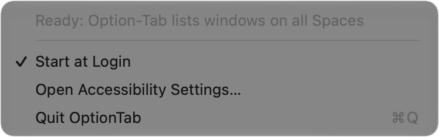

# Menu on reopen

## What was done
If you open OptionTab again while it runs, OptionTab shows its menu at the mouse pointer. You can open it again from Finder, from Spotlight, or with `open`. This gives a second way to the menu, because macOS hides the menu bar item when the menu bar is full. The menu is the same menu as in the menu bar.

## Files created / modified
| File | Action | Purpose |
|------|--------|---------|
| `Sources/OptionTab/AppDelegate.swift` | Modified | Adds `applicationShouldHandleReopen`. It shows the status item menu at the mouse pointer. |
| `docs/04_start_at_login.md` | Modified | The removal steps use the menu on reopen. |
| `docs/05_app_icon.md` | Modified | The hidden menu bar item limit points to this file. |
| `docs/images/06_reopen_menu.png` | Created | Capture of the menu after a reopen |

## Use
1. Open Raycast or Spotlight.
2. Type "OptionTab" and press Return.
3. The OptionTab menu opens at the mouse pointer. Click an item, or click outside the menu to close it.

Double-click `/Applications/OptionTab.app` in Finder for the same result.

## How it works
1. macOS sends a reopen event to an app that runs already. `NSApplication` then calls `applicationShouldHandleReopen` on the delegate.
2. The delegate shows the status item menu with `NSMenu.popUp(positioning:at:in:)` at `NSEvent.mouseLocation`.
3. The call is on the next main-queue turn. The menu runs its own event loop until it closes, and the reopen event must return first.
4. OptionTab does not activate itself. The focus stays on the app that you used before. Option-Tab then lists the windows of that app, as before.

The menu delegate updates the "Start at Login" item before the menu opens, also for this menu.

## Test results (2026-10-18, macOS 27.0.1)
| Test | Result |
|------|--------|
| `open ~/Applications/OptionTab.app` while OptionTab runs (the install path at the time of the test) | A menu window (level 101) of OptionTab opens at the mouse pointer |
| Menu items, read through Accessibility | Status line, Start at Login (with checkmark), Open Accessibility Settings…, Quit OptionTab |
| Menu stays open | Open for 6 s, until the test closed it |
| Frontmost app after the reopen | Not OptionTab. The focus does not change. |
| Close through Accessibility (`AXCancel`) | The menu closes |

## Not tested
- **Spotlight and Finder.** The test used `open`. Spotlight and Finder send the same reopen event through Launch Services, but the test did not use them.
- **A click on an item in this menu.** The items are the same objects as in the menu bar menu. The test of the menu bar menu toggled "Start at Login" off and on. See [04_start_at_login.md](04_start_at_login.md).
- **The keyboard in this menu.** OptionTab is not the active app, so the arrow keys possibly do not move in the menu. Use the mouse.

## Why it matters
On this Mac, the menu bar is full next to the camera housing, so macOS hides the OptionTab icon. Without this change, you had no way to see if OptionTab was ready, to turn "Start at Login" off, or to quit it, except from Terminal.

Now the normal Mac habit works: if you can't find a running app, you open it again. This doesn't need a new window or a settings screen. It reuses the menu that is already there.
